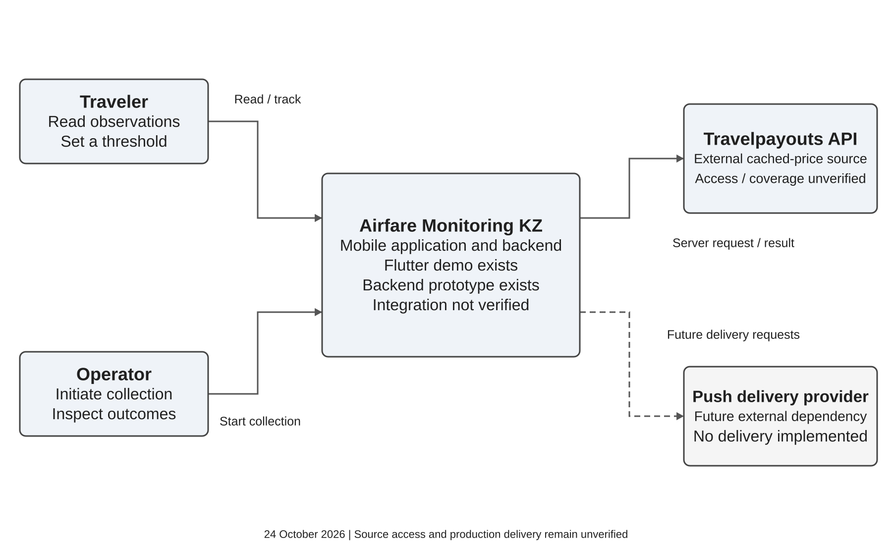
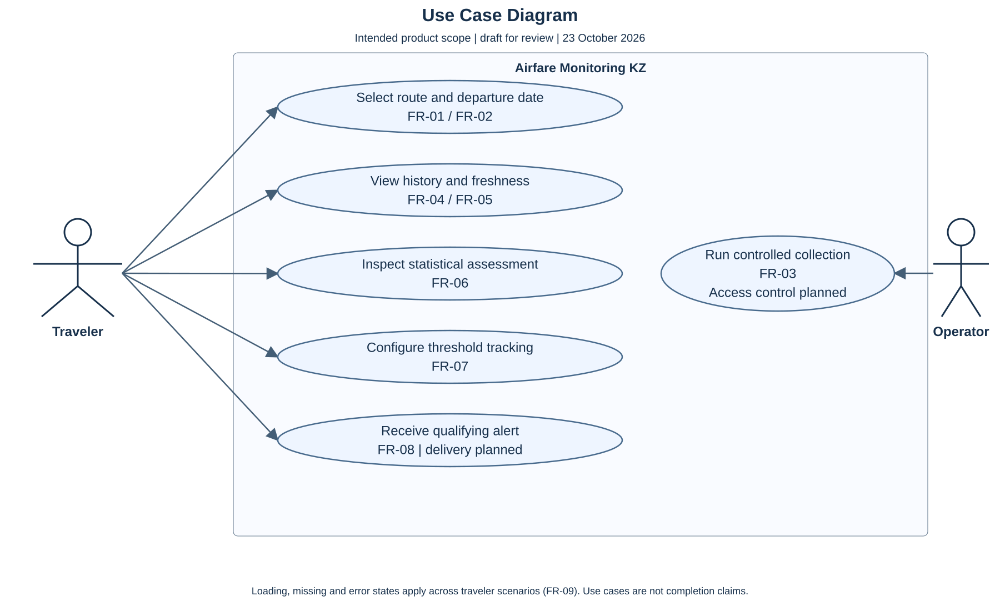
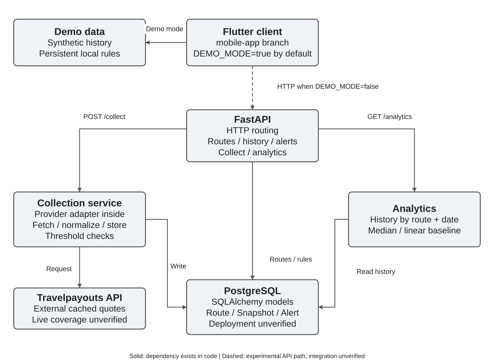
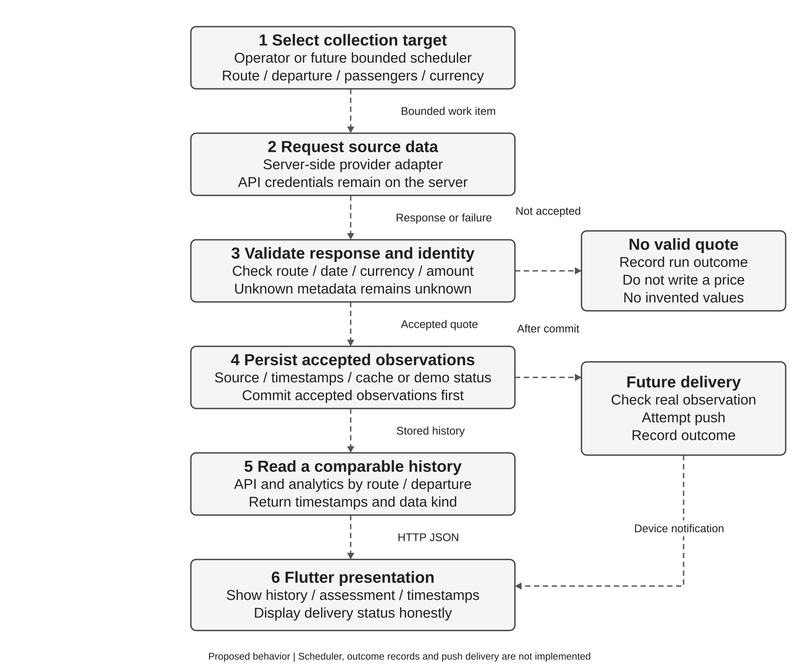
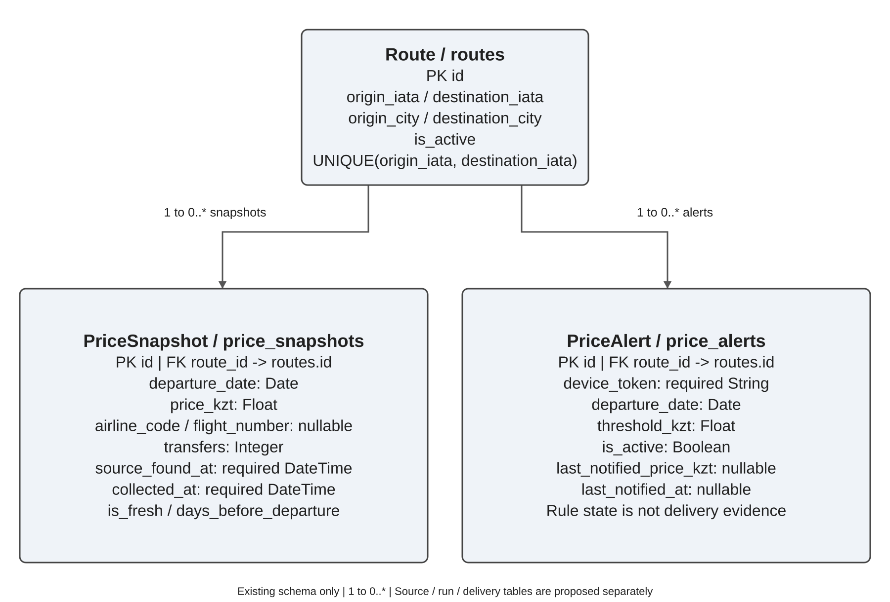

# Architecture and diagrams

**Status:** corrected against GitHub source snapshots on 24 October 2026; student and supervisor review pending.  
**Related issues:** [#5](https://github.com/Swoksaar0/airfare-monitoring-kz/issues/5), [#12](https://github.com/Swoksaar0/airfare-monitoring-kz/issues/12).

The project uses a Flutter client and a Python/FastAPI backend with SQLAlchemy models and PostgreSQL configuration. The current component view describes dependencies visible in code. The target data-flow view describes the corrections and future integrations needed for reliable monitoring; it is not evidence that those behaviors already work.

The backend was inspected at [4c16b326](https://github.com/Swoksaar0/airfare-monitoring-kz/tree/4c16b32647e9dc780eec368a4ce20f015986c539/backend), and the Flutter client at [d14b0d8a](https://github.com/Swoksaar0/airfare-monitoring-kz/tree/d14b0d8ae006b84e34b33470ba1b168849222057/mobile). The 24 October verification uses mocked offline collection and a disposable SQLite database; no provider contact, PostgreSQL deployment or push delivery is established. See VERIFICATION_RESULTS.md.

## System Context Diagram



Editable source: [system-context.puml](diagrams/system-context.puml).

The system boundary contains the mobile application and its supporting backend. Travelers inspect observations and set thresholds. An operator initiates collection; operator authorization remains to be implemented. Travelpayouts is the external source currently referenced by backend request code. Its adapter is internal to the collection service, rather than a separate external system. A future push provider is an external delivery dependency. The presence of adapter code does not establish source access, domestic coverage or live prices.

## Use Case Diagram



Editable source: [use-cases.puml](diagrams/use-cases.puml).

The diagram describes intended scope: route/date selection (FR-01/02), history and freshness (FR-04/05), assessment (FR-06), threshold tracking (FR-07), future notification receipt (FR-08), and operator collection (FR-03). FR-09 applies to loading, missing and error states. The Flutter demo already implements part of these scenarios; a future-date selector and persistent local rules are now implemented; delivered push and native validation remain outstanding.

## Current Component Diagram



Editable source: [components.puml](diagrams/components.puml).

Solid arrows identify dependencies present in source code, not successful production deployment. The dashed Flutter-to-FastAPI arrow is an experimental HTTP path: the default build uses local demo fixtures, and integration has not been demonstrated. Collection and analytics are Python services inside the backend, not independently deployed microservices.

| Component | Responsibility | Current state |
| --- | --- | --- |
| Flutter client and ApiService | Present routes, history, assessment and threshold feedback | In `mobile-app`; `DEMO_MODE=true` uses fixtures. HTTP methods exist for API mode; end-to-end integration remains unverified. |
| Demo fixtures and local preferences | Supply synthetic route/date history; persist date, favorites and rules | SharedPreferences on the device/browser, with demo/API scopes separated; no server alert creation. |
| FastAPI endpoints | Route HTTP requests, validate payloads and obtain a DB session | `backend/app/main.py`; calls collector and analytics functions, and queries/writes ORM models. |
| Collection service and provider adapter | Request cached quotes, normalize, add snapshots and check rules | `services/collector.py`; the adapter function is inside this service. Fallback and timestamp defects remain. |
| Analytics service | Read history for a route/departure and calculate an assessment | `services/analytics.py`; median and linear baseline, with no validated forecast accuracy. |
| SQLAlchemy and PostgreSQL | Persist routes, snapshots and alert rules | Models and Compose configuration exist; deployment was not verified in this review. |
| Scheduler | Select bounded repeated work | Planned; no scheduler service or persistent run queue exists in the inspected code. |
| Push adapter and provider | Attempt delivery and record outcomes | Planned; current threshold checks update fields without sending a push. |

## Data flow

### Current execution

1. Backend import creates ORM tables; startup seeds 12 candidate directions.
2. `POST /api/v1/collect` synchronously calls the collector for all active routes and one date derived from `days_ahead`.
3. The adapter calls Travelpayouts when configured. Missing data, missing credentials or request failure can produce a random fallback quote.
4. The collector adds snapshots, changes qualifying alert state and commits. No push request is sent.
5. Read endpoints query history or invoke analytics. Flutter's default demo bypasses these endpoints entirely.

This is the existing execution path, including its defects. It is not suitable evidence of trustworthy live observations.

### Target collection and delivery



Editable source: [data-flow.puml](diagrams/data-flow.puml).

The operator or future scheduler selects a route, fixed departure date and comparison context under a configured request budget. The server adapter obtains data; validation distinguishes accepted quotes, no-result responses and failures. A missing or failed result creates a run outcome rather than a fabricated price. Accepted observations preserve source identity, collection time, any supplied source time and cache/demo status. Unknown source time stays unknown.

After persistence, read APIs return histories grouped by route, departure and comparable offer context. Analytics uses the same grouping. A future delivery worker evaluates qualifying real observations, attempts push delivery and records the outcome separately. Updating `last_notified_at` is not proof that a notification was sent or received.

The target flow requires code changes and migrations. Its outcome records, source/demo fields, scheduler and delivery log are not present in the current schema.

## Interfaces and current gaps

The current endpoints are `GET /health`, `GET /api/v1/routes`, `POST /api/v1/collect`, `GET /api/v1/routes/{route_id}/history`, `GET /api/v1/routes/{route_id}/analytics`, and `POST /api/v1/alerts`.

History currently filters by route and optionally `is_fresh`, but lacks a server-side departure-date filter. Analytics accepts a departure date. The updated Flutter HTTP method passes the selected date and filters returned route/date records locally; the backend still ignores that date on history requests. This client safeguard does not replace the missing server filter.

Before production integration: remove silent simulated fallback from real collection; preserve unknown metadata and correct timestamp semantics; add explicit source/offer identities and currency context; validate returned route/date; authorize collection; validate alert routes and support deactivation. Keep credentials in server configuration. The scheduler should use bounded sequential work and explicit quota/error handling, rather than unbounded automatic retries.

The inspected repository has no SCAT parser module, raw-capture storage or guaranteed four-airline integration. Those can be added through server-side adapters after implementation and source-access validation; they are not shown as completed components.

## Storage relationships



Editable source: [entities.puml](diagrams/entities.puml).

One `Route` can have zero or many `PriceSnapshot` records and zero or many `PriceAlert` rules. Each child has one required `route_id` foreign key. There is no direct snapshot-to-alert foreign key. The directional airport pair is unique; the reverse direction is a different route.

`PriceSnapshot` stores a departure date, `Float` amount in KZT, optional airline/flight identifiers, transfers, required source/collection timestamps, a freshness flag and booking horizon. `PriceAlert` stores a device token, route/date, `Float` threshold, activity and nullable last-notified fields. The diagram reproduces these existing types; it does not imply that their design is final.

Proposed migrations use exact money, timezone-aware timestamps and nullable unknown source time; add provenance and observation identity; and introduce collection outcomes and delivery attempts. Define the deduplication key after observing actual provider identifiers. No such migration is applied by this documentation update.

## Diagram reproducibility

The context, component, entity and target-flow previews and their PlantUML sources are generated from shared labels and relationships by [render_architecture.py](diagrams/render_architecture.py). Their layouts may differ when PlantUML renders the editable sources. The existing use-case diagram remains a separate editable source.

With Python and Pillow available, run from the repository root:

```sh
python docs/diagrams/render_architecture.py --output docs/diagrams
```

This regenerates SVG previews, PNG images for the report and matching `.puml` sources. It makes no network or collection requests. Diagram edges show component dependencies or the explicitly labeled target flow; they do not assert deployed services or measured success.


