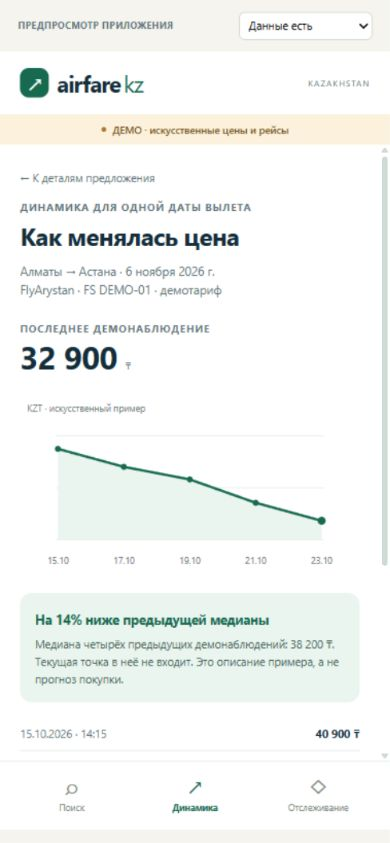

# Earlier browser UI reference

The primary application prototype is now [Flutter/Dart](../../mobile/README.md). This HTML sketch is retained only as an optional visual reference.

**Status:** first reviewable prototype, 23 October 2026. User and supervisor evaluation are pending.  
**Related issue:** [#6](https://github.com/Swoksaar0/airfare-monitoring-kz/issues/6).

This browser-based prototype demonstrates the intended mobile scenarios. It is a checkpoint artifact, not the Flutter application or a connection to the backend. The interface language is Russian; localization remains future work.

## Open the prototype

Download or check out the PR branch containing these files. From that repository root, run:

```sh
python -m http.server 8765 --bind 127.0.0.1 --directory docs/prototype
```

Open [the local prototype](http://127.0.0.1:8765/). Stop the server with Ctrl+C. No dependency installation, API key or database is needed. An alternative is to open `index.html` directly; browser policy may limit persistent storage for local files. GitHub's file preview displays HTML source and does not run the prototype.

## Walkthrough

1. Keep **Алматы → Астана, 6 November 2026** selected and press **Посмотреть предложения**.
2. Open an offer with **Подробнее**. Inspect the fictional flight identifier, time, price and explicit unknown baggage fields.
3. Choose **Посмотреть историю цены**. The graph and observation list concern the same departure date and selected offer.
4. Choose **Настроить отслеживание**, enter a positive whole-tenge threshold, and save a **demo rule**.
5. Reload: the rule remains in this browser when localStorage is available. Disable/re-enable it or display a manually triggered notification example.
6. Use the **Состояние** selector above the phone to inspect loading, empty, error and stale-data scenarios. Retry returns to the demo fixture.
7. Choose another route or date: the prototype shows that no demo observations exist; it does not infer that real flights are unavailable.

On a wide screen the left scenario shortcuts start the default fixture. The phone navigation and back buttons also work. On a narrow screen only the mobile preview is shown.

## Data and interaction boundaries

- All prices, flight identifiers, schedules and history are explicitly synthetic. Carrier names are used only to illustrate presentation; no carrier coverage is established.
- The fixture contains three offers for ALA→NQZ on 2026-11-06. The 12-direction selector mirrors the repository's candidate route list; the other combinations intentionally have no fixtures.
- The observation dates are 15–23 October 2026; the departure date stays 6 November. The prototype uses a fixed demo period rather than a live clock.
- Baggage allowances are unknown and never inferred from a carrier name.
- The displayed prior median uses the four earlier synthetic observations and excludes the latest point. It is a descriptive example, not a trained model or a purchase guarantee.
- Rules are browser-local demo data, separate from the backend database. Saving is an upsert for the same route/date/offer. No contact details, permission prompts or device tokens are used.
- The notification example is rendered in-page after a button press. No real push is delivered and no real price decrease has been detected.
- There are no external assets or source requests. The HTML policy disables network connections with `connect-src 'none'`.

## Screen exports

These are screenshots of the rendered prototype at 390×844, not fabricated app screenshots. The phone content scrolls; each export shows its initial viewport.

| Scenario | Export |
| --- | --- |
| Route and date | [search.jpg](screenshots/search.jpg) |
| Offers | [offers.jpg](screenshots/offers.jpg) |
| Offer details | [details.jpg](screenshots/details.jpg) |
| History and assessment | [history.jpg](screenshots/history.jpg) |
| Threshold form | [track-form.jpg](screenshots/track-form.jpg) |



## Verification performed on 23 October 2026

- JavaScript syntax checked with `node --check app.js`.
- Exercised search → offers → details → history → threshold → saved-rule navigation in the browser.
- Confirmed a zero threshold is rejected and a 30,000 KZT rule is saved.
- Reloaded and confirmed browser-local persistence; disabled the rule and confirmed its notification-preview button is disabled.
- Displayed the manual notification example, loading, empty, error/retry and stale-data scenarios.
- Selected another route and another departure date; each showed the explicit absence of demo observations.
- Inspected the mobile layout at 390×844; the document width was 390 pixels with no horizontal overflow.

These checks do not establish native Android/iOS behavior, live fares, backend integration, real notification delivery, accessibility conformance, or usability findings from target users. Review the prototype with actual users before accepting issue #6.

## Source files

- [index.html](index.html): preview shell and state controls.
- [styles.css](styles.css): responsive mobile screens and presentation layout.
- [app.js](app.js): synthetic fixtures, navigation, graph and browser-local demo rules.

Requirements mapping: FR-01/02 selection; FR-04/05 history and freshness presentation; FR-06 descriptive example; FR-07/08 demo tracking and notification presentation; FR-09 state screens; FR-11 synthetic-data labeling. This mapping describes prototype coverage, not backend acceptance.
