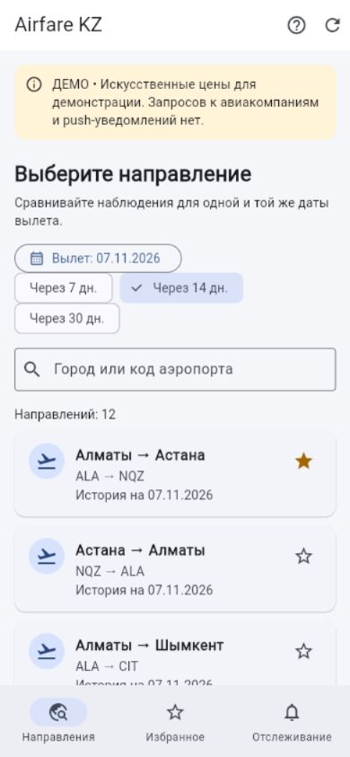
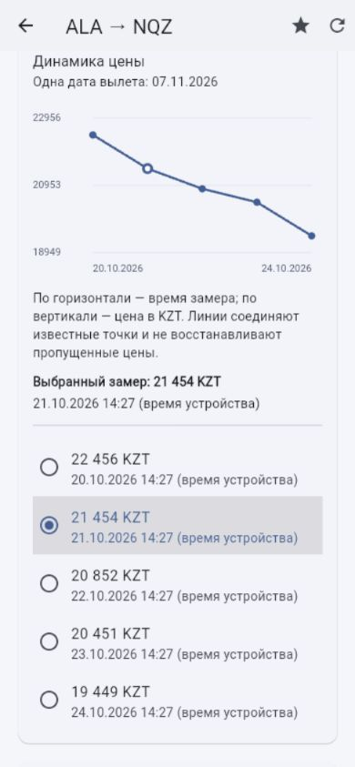

# Flutter prototype — Airfare Monitoring KZ

Version 0.2.0, checked on 24 October 2026. This is the Flutter/Dart application prototype included in the `prob-period-1` snapshot. The same tag includes backend/ and [checkpoint documents](../docs/README.md). The source revision is recorded in [SUBMISSION.md](../SUBMISSION.md).

## What works in the prototype

- Search twelve selected domestic directions by city or IATA code; reverse directions remain distinct.
- Select a future departure date through the Russian date picker or +7/+14/+30-day shortcuts.
- Inspect a route/date-specific history, select individual observations and read exact prices and collection times.
- Compare the last observation with the median of earlier observations; the current observation is excluded. This is descriptive analysis, not a forecast or purchase recommendation.
- Save favorites, the selected date and local price-threshold rules with SharedPreferences; restore them after page/application recreation.
- Keep separate rules for different departure dates; edit the amount, deactivate/reactivate or delete a rule.
- Demonstrate loading, no observations, request failure, old observations and insufficient history through the labeled scenario selector.
- Distinguish source time from collection time. Unknown source metadata remains unknown; a source timestamp later than collection is flagged.
- Read on a phone-width layout with text alternatives to the chart and Russian calendar controls.

The prices are synthetic examples. They vary by selected direction/date so that the interface can demonstrate filtering, but they are not real offers or evidence for model accuracy. There is no individual-flight inventory, verified baggage comparison, push delivery or account synchronization.

Favorites and rules are device-local preferences, not a reliable server-side notification queue. Browser storage is scoped to the site origin; changing hostname/port creates a different store. Clearing browser data removes preferences. Demo and experimental API mode use separate storage keys.

## Run

Checked with Flutter 3.47.5 / Dart 3.13.4 on Windows. From a clean checkout:

```sh
git fetch origin tag prob-period-1
git switch --detach prob-period-1
cd mobile
flutter pub get
flutter --no-version-check run -d web-server --web-hostname=127.0.0.1 --web-port=8767 --dart-define=DEMO_MODE=true
```

Open [the local prototype](http://127.0.0.1:8767/). Stop the server with Ctrl+C. The port is an example; keep the same origin if testing preference restoration.

Alternatively, build and serve the static Flutter Web output:

```sh
flutter --no-version-check build web --no-pub --no-web-resources-cdn --dart-define=DEMO_MODE=true
python -m http.server 8767 --bind 127.0.0.1 --directory build/web
```

This is Dart compiled by Flutter, not the earlier hand-written HTML reference. Android/iOS launch folders and native behavior have not been validated. A phone-width browser check does not establish an Android APK or an iOS build.

## Demonstration walkthrough

1. Search for `NQZ`, select a future date and star a direction.
2. Open the direction. Verify that the selected departure date stays the same while observation dates change.
3. Inspect the graph and tap an observation in its text list. Check the prior-history median and data-source labels.
4. Save a positive threshold such as `25 000,50`. Zero, negative values, non-numeric input and more than two decimal places are rejected.
5. Open **Отслеживание**, turn the rule off/on, and open its history. Rules for a different departure date are independent.
6. Reload the page: the date, favorite and rule remain stored. No notification is claimed.
7. In detail view, use **Учебный сценарий** to show no data, error, old data or one observation. An empty history does not mean that no flights operate.

## Experimental API mode

Run with `--dart-define=DEMO_MODE=false --dart-define=API_BASE_URL=http://127.0.0.1:8000` only for controlled integration work.

The client reads routes and history. History requests include `departure_date` and `only_fresh=false`, then filter the response locally by route/date because the current backend lacks that server-side filter. HTTP failures remain errors; generated prices are never substituted. The client computes its descriptive summary from that selected history, rather than using the backend's unvalidated analytics score.

Tracking remains local in API mode. The client does not register devices, create server alerts or claim server deactivation. No provider key or device token belongs in this Web build.

Backend source/provenance and timestamp defects, CORS, live coverage and real notification delivery still need independent work. API-mode data must not be presented as verified current fares.

## Verification

```sh
flutter --no-version-check analyze --no-pub
flutter --no-version-check test --no-pub
flutter --no-version-check build web --no-pub --no-web-resources-cdn --dart-define=DEMO_MODE=true
```

Recorded on 24 October 2026:

- Static analysis: no issues.
- Seventeen unit/widget tests passed, including date rejection, history grouping, prior-median calculation, input validation, independent rules, durable preference restoration, mode isolation, queued writes and failure states.
- Release Web build succeeded with local CanvasKit resources and both Material/Cupertino icon fonts.
- Browser checks at 390 × 844: selection of a different departure date, favorite, selected graph observation, rule saving/deactivation, actual page reload/restoration, and separate no-data/error states.
- Narrow-screen widget checks include a 1.6 text scale. This is not a native screen-reader audit.
- No airline/provider requests, backend deployment or push delivery were performed.

See [REVIEW_NOTES.md](REVIEW_NOTES.md) for the implementation boundary. Student/user/supervisor feedback remains outstanding; the prototype is ready for review, not a completed production application.

## Interface snapshots

Synthetic demonstration data, captured in a browser viewport of 390 × 844 on 24 October 2026. These are Web screenshots, not native-device verification.

| Directions and departure date | Selected observation in history |
| --- | --- |
|  |  |
